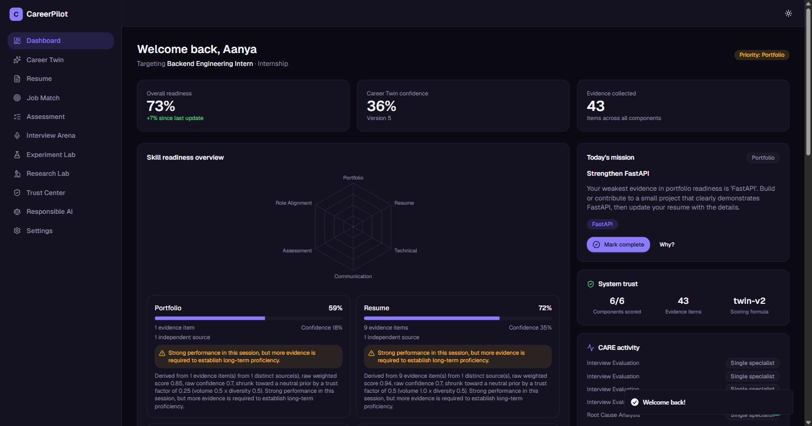
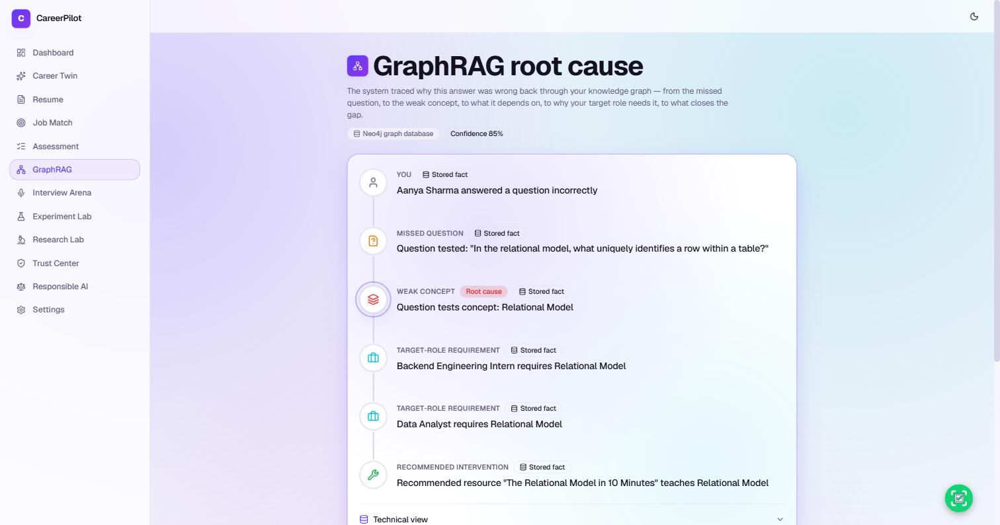
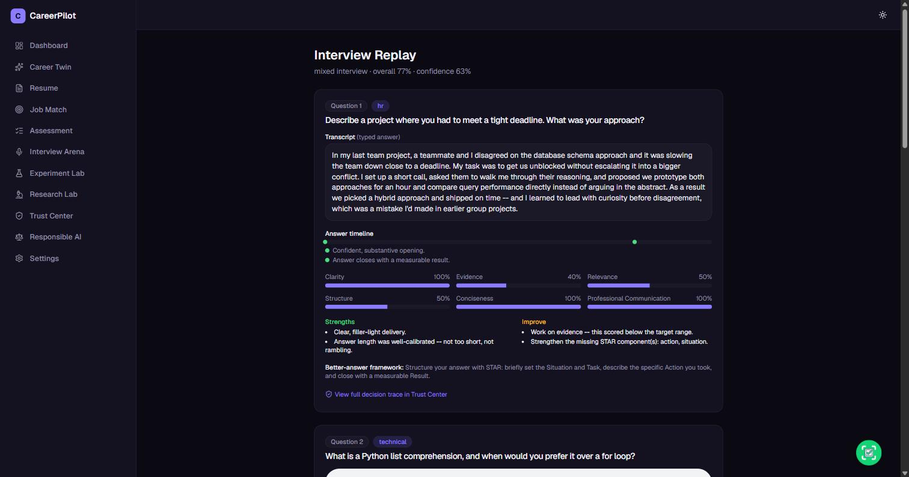
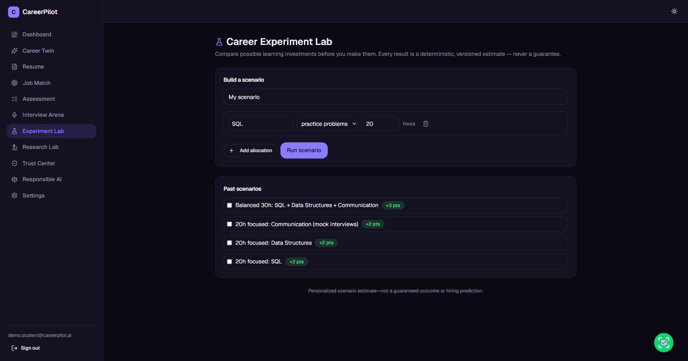
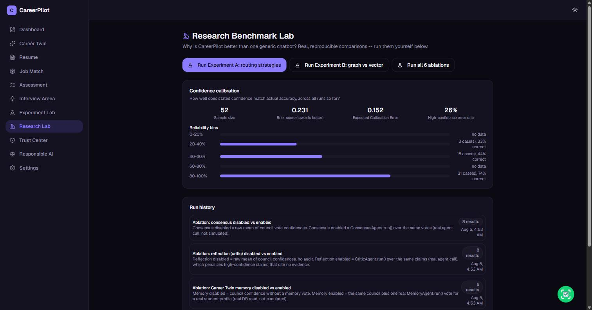
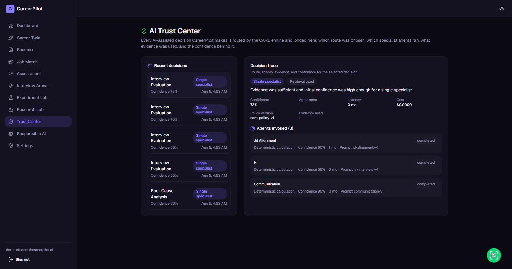
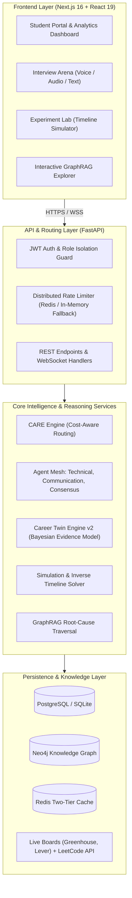

# CareerPilot AI

<div align="center">

[](https://github.com/Likhith1807/careerpilot-ai/actions/workflows/ci.yml)
[](https://www.python.org/)
[](https://fastapi.tiangolo.com/)
[](https://nextjs.org/)
[](https://react.dev/)
[](https://www.docker.com/)
[](LICENSE)
[](https://mypy-lang.org/)
[](https://github.com/astral-sh/ruff)

**An Evidence-Grounded, Confidence-Aware Agentic Career Operating System**

*Bridging the gap between student preparation and enterprise hiring through deterministic digital twins, hierarchical knowledge graphs, and adaptive multi-agent consensus.*

[Architecture](docs/architecture.md) • [Contributing](CONTRIBUTING.md) • [Changelog](CHANGELOG.md) • [Security](SECURITY.md)

</div>

---

## 📌 Executive Summary

Most career readiness tools are thin wrapper interfaces around generic Large Language Models—resulting in hallucinated feedback, arbitrary scoring heuristics, and zero reproducibility.

**CareerPilot AI** re-engineers career readiness from first principles:
- **Zero Hallucinated Scoring**: Every score, readiness percentage, and gap analysis is mathematically grounded in observable student artifacts (parsed resumes, verified quiz responses, LeetCode submissions, and transcribed interview sessions).
- **Career Twin Engine v2**: A Bayesian competency model utilizing evidence-weighted shrinkage, freshness time-decay, and small-sample safeguards.
- **CARE Engine (Cost-Aware Routing Engine)**: Dynamic routing that arbitrates between low-latency single-agent heuristics and parallel multi-agent consensus based on task ambiguity and confidence variance.
- **GraphRAG Root-Cause Traversal**: A Neo4j-backed knowledge graph of CS concepts, prerequisites, and blocker hierarchies, paired with a seamless relational fallback.
- **Self-Healing & Fail-Open**: Built with enterprise resilience; missing services (Neo4j, Redis, external job boards) degrade gracefully without breaking user workflows.

---

## 📸 Platform Showcase

<div align="center">

| Student Command Center | GraphRAG Root-Cause Discovery |
| :---: | :---: |
|  |  |

| Multi-Agent Interview Arena | Experiment Lab (Timeline Solver) |
| :---: | :---: |
|  |  |

| Empirical Research Lab | AI Trust & Auditability Center |
| :---: | :---: |
|  |  |

</div>

---

## 🏛️ System Architecture

CareerPilot AI follows a decoupled modern architecture combining a **FastAPI** microservice layer with a **Next.js 16 (React 19)** web client, backed by **PostgreSQL**, **Neo4j**, and **Redis**.



For detailed specifications, data flows, and routing algorithms, see [System Architecture Documentation](docs/architecture.md).

---

## ⚡ Core Innovations & Capabilities

### 1. The CARE Engine (Cost-Aware Routing Engine)
Generative multi-agent workflows are notoriously slow and expensive. The CARE engine dynamically evaluates incoming tasks against four routing factors:
1. Primary agent confidence score
2. Evidence artifact density
3. Discrepancy margin between evaluation metrics
4. Task complexity tier

- **Fast Path (Single Agent)**: Low ambiguity, high confidence $\rightarrow$ returns in ~250ms with minimal compute cost.
- **Deep Path (Multi-Agent Consensus)**: Ambiguous input or borderline performance $\rightarrow$ parallel execution of Technical and Communication agents with Consensus Arbiter synthesis (~900ms).

### 2. Career Twin Engine v2
Computes student competency across taxonomy domains:
- **Bayesian Shrinkage**: Regresses sparse evidence points toward a neutral prior, eliminating false mastery signals from single-question quizzes.
- **Temporal Freshness Decay**: Exponentially decays inactive skills over time, encouraging continuous retention.
- **Small-Sample Safeguards**: Automatically flags unverified domains rather than outputting misleading zeros or arbitrary values.

### 3. GraphRAG Knowledge Representation
Constructs a directed acyclic graph (DAG) connecting concepts, prerequisite dependencies, failed questions, and recommended learning resources. When a student fails an assessment question, GraphRAG traverses upstream dependencies to identify root-cause conceptual gaps (e.g., failed *Database Normalization* traced to unmastered *Set Theory and Relational Algebra*).

### 4. Interactive Interview Arena
- Simulates real-time technical and behavioral interviews with dynamic follow-up generation.
- Independent multi-agent scoring breakdown across technical accuracy, communication structure, and tone confidence.
- Interactive interview replay with granular turn-by-turn critique.

### 5. Experiment Lab (Inverse-Mode Timeline Solver)
- Solves backwards from target graduation dates: *"I need 85% readiness for a Data Platform Engineer role in 12 weeks with 8 available hours per week."*
- Generates a calendar-shaped weekly allocation schedule respecting prerequisite DAG order.
- Runs Monte Carlo sensitivity analysis to calculate realistic outcome probabilities.

### 6. Live Job Intelligence Feed
- Ingests real-time job openings from official Greenhouse and Lever API feeds.
- Parses requirements against the platform's skill taxonomy.
- Employs a fail-open two-tier Redis caching model (6-hour fresh cache, 7-day last-known-good fallback).

---

## 🛠️ Technology Stack

| Domain | Technologies |
| :--- | :--- |
| **Backend Framework** | [FastAPI](https://fastapi.tiangolo.com/), [Pydantic v2](https://docs.pydantic.dev/), [Python 3.10+](https://www.python.org/) |
| **ORM & Database** | [SQLAlchemy 2.0](https://www.sqlalchemy.org/), [Alembic](https://alembic.sqlalchemy.org/), [PostgreSQL](https://www.postgresql.org/) / [SQLite](https://www.sqlite.org/) |
| **Knowledge Graph** | [Neo4j](https://neo4j.com/) (Cypher query language) with Relational CTE fallback |
| **Caching & Rate Limiting**| [Redis](https://redis.io/) (token-bucket rate limiter with fail-open in-memory memory fallback) |
| **Frontend Framework** | [Next.js 16](https://nextjs.org/) (App Router), [React 19](https://react.dev/), [TypeScript 5](https://www.typescriptlang.org/) |
| **Styling & Components**| [Tailwind CSS v4](https://tailwindcss.com/), [Framer Motion](https://www.framer.com/motion/), [Radix UI](https://www.radix-ui.com/), [Lucide Icons](https://lucide.dev/) |
| **Data Visualization** | [Recharts](https://recharts.org/), [Anime.js](https://animejs.com/) |
| **Testing & Quality** | [Pytest](https://docs.pytest.org/), [Vitest](https://vitest.dev/), [Ruff](https://github.com/astral-sh/ruff), [Mypy](https://mypy-lang.org/) |
| **Containerization** | [Docker](https://www.docker.com/), [Docker Compose](https://docs.docker.com/compose/) |

---

## 📂 Repository Structure

```text
careerpilot-ai/
├── .github/
│   ├── workflows/ci.yml             # GitHub Actions CI pipeline
│   ├── ISSUE_TEMPLATE/              # Structured bug & feature templates
│   └── PULL_REQUEST_TEMPLATE.md     # Standardized review checklist
├── backend/
│   ├── alembic/                     # Database migrations (Phase 1 & Phase 2)
│   ├── app/
│   │   ├── agents/                  # Specialist agents (Technical, Comm, Consensus)
│   │   ├── api/                     # REST API route handlers
│   │   ├── care_engine/             # Cost-Aware Routing Engine & policy
│   │   ├── career_twin/             # Bayesian student competency engine
│   │   ├── core/                    # Security, database sessions, Redis client, config
│   │   ├── evaluation/              # Fairness probes, efficiency frontiers, ablations
│   │   ├── graphrag/                # Neo4j client, Cypher queries, relational fallback
│   │   ├── models/                  # SQLAlchemy ORM declarative models
│   │   ├── schemas/                 # Pydantic validation schemas
│   │   ├── services/                # Business logic and domain orchestrators
│   │   └── simulation/              # Inverse solver and calendar planning engine
│   ├── tests/                       # Unit, integration, and security regression suite
│   ├── pyproject.toml               # Tool configuration (Ruff, Mypy, Pytest)
│   └── requirements.txt             # Python dependencies
├── frontend/
│   ├── app/                         # Next.js App Router pages and layouts
│   ├── components/                  # Reusable UI component library
│   ├── lib/                         # API clients, auth helpers, utility functions
│   └── tests/                       # Vitest component and hook test suite
├── docs/                            # Architectural specs, research notes, and presentation
│   ├── architecture.md              # In-depth system architecture & diagrams
│   └── presentation/screenshots/    # UI screenshots and visual assets
├── docker-compose.yml               # Multi-service local deployment stack
├── CONTRIBUTING.md                  # Development guidelines and setup
├── SECURITY.md                      # Security policy and disclosure process
├── CODE_OF_CONDUCT.md               # Contributor Covenant Code of Conduct
├── CHANGELOG.md                     # Release history and milestone tracker
└── LICENSE                          # MIT License
```

---

## 🚀 Quick Start Guide

### Option 1: Docker Compose (Recommended)

The fastest way to experience CareerPilot AI with all services (Postgres, Neo4j, Redis, Backend, Frontend) pre-configured:

```bash
# Clone the repository
git clone https://github.com/Likhith1807/careerpilot-ai.git
cd careerpilot-ai

# Build and start all 5 containers
docker compose up -d --build
```

Once running:
- **Frontend Portal**: [http://localhost:3000](http://localhost:3000)
- **Interactive Swagger API Docs**: [http://localhost:8000/docs](http://localhost:8000/docs)
- **Dependency Health Check**: [http://localhost:8000/api/v1/health/dependencies](http://localhost:8000/api/v1/health/dependencies)

#### Demo Account Credentials
The database automatically seeds a complete demo profile with pre-populated Career Twin state, interview transcripts, and GraphRAG evidence:
```text
Email:    demo.student@careerpilot.ai
Password: DemoPass!2026
```

---

### Option 2: Local Development Setup (Manual)

#### 1. Backend Setup
```bash
cd backend
python -m venv .venv

# Activate virtual environment
# Windows:
.\.venv\Scripts\activate
# Linux/macOS:
source .venv/bin/activate

# Install dependencies
pip install -r requirements.txt
pip install ruff mypy pytest pytest-asyncio httpx

# Configure environment variables
cp .env.example .env

# Run database migrations
alembic upgrade head

# Seed initial knowledge graph and demo student
python -m app.graphrag.run_seed
python -m app.seed.seed_demo

# Start FastAPI development server
uvicorn app.main:app --reload --port 8000
```

#### 2. Frontend Setup
```bash
cd frontend

# Install npm packages
npm install

# Start Next.js development server
npm run dev
```

Visit `http://localhost:3000` to interact with the application.

---

## 🧪 Testing & Verification

CareerPilot AI maintains strict verification standards with end-to-end type safety, zero lint warnings, and comprehensive test coverage.

### Run Backend Verification
```bash
cd backend

# 1. Fast static code analysis (Ruff)
ruff check .

# 2. Strict static type check across 196 source files (Mypy)
mypy app --ignore-missing-imports

# 3. Comprehensive test suite (315+ passing tests)
pytest -v
```

### Run Frontend Verification
```bash
cd frontend

# 1. ESLint check
npm run lint

# 2. Vitest test suite (105+ tests across 24 suites)
npm test
```

---

## 🔒 Security & Data Isolation

- **Zero Data Leakage**: Enforced row-level student isolation across all queries.
- **Fail-Open Rate Limiting**: Distributed Redis token-bucket limiter with automatic in-memory fallback ensures high availability during transient infrastructure failures.
- **Cryptographic Protection**: Secure password hashing with Argon2 and cryptographically signed JWT tokens.
- **Synthetic Testing**: All automated test suites operate against ephemeral databases using synthetic mock data.

---

## 👥 Contributors & Core Maintainers

CareerPilot AI was architected and developed by:

- **Likhith** ([@Likhith1807](https://github.com/Likhith1807))
  *System Architecture, Core Platform Implementation, Backend Microservices & API Design*
- **Karthikeya** ([@karthikeya020](https://github.com/karthikeya020))
  *AI/ML Reasoning Engine, Feature Engineering, Research Benchmarking & Optimization*

---

## 📄 License

This project is licensed under the [MIT License](LICENSE).

