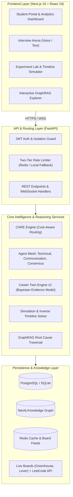
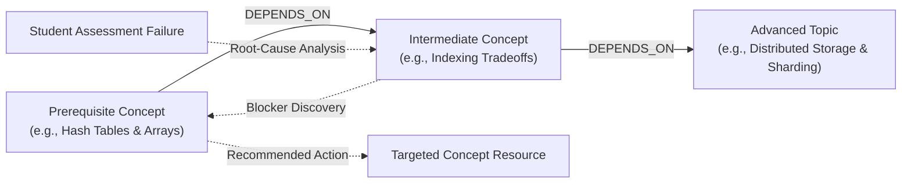

# CareerPilot AI — System Architecture & Design Specification

CareerPilot AI is an enterprise-grade AI career readiness platform designed to evaluate, guide, and accelerate software engineering and technical career paths.

Unlike conventional career tools that rely on generic generative AI prompts, CareerPilot AI implements a **deterministic evidence framework**, a **Bayesian digital competency model (Career Twin)**, a **hierarchical prerequisite knowledge graph (GraphRAG)**, and an **adaptive multi-agent evaluation engine (CARE Engine)**.

---

## 1. High-Level System Architecture



---

## 2. The CARE Engine (Cost-Aware Routing Engine)

The **CARE Engine** solves the fundamental latency and cost dilemma inherent in multi-agent generative systems. Rather than blindly invoking an expensive multi-agent consensus on every interaction, CARE dynamically calculates an information-theoretic confidence score and routes tasks accordingly.

```mermaid
flowchart TD
    Task[Incoming Evaluation Task] --> Heuristic[Fast Single-Agent Evaluation]
    Heuristic --> Calc{Evaluate Routing Factors\n- Agent Confidence\n- Evidence Density\n- Discrepancy Margin}
    Calc -->|High Confidence & Clear Evidence| SingleRoute[Single-Agent Fast Path\nLatency: ~250ms | Cost: 1x]
    Calc -->|Uncertainty / Ambiguity Detected| MultiRoute[Multi-Agent Consensus\nTechnical + Communication Agents]
    MultiRoute --> Consensus[Consensus Arbiter Agent\nLatency: ~900ms | Cost: 3x]
    SingleRoute --> Result[Normalized Assessment Result]
    Consensus --> Result
```

### Key Routing Principles
1. **Low-Ambiguity Tasks**: Strong keyword alignment, standard syntax, and high primary agent confidence bypass multi-agent voting.
2. **High-Ambiguity Tasks**: Subtle phrasing, edge cases, or borderline confidence trigger parallel multi-agent evaluation.
3. **Consensus Arbitration**: Evaluates confidence variance across diverse scoring perspectives to eliminate scoring bias.

---

## 3. GraphRAG Knowledge Representation

CareerPilot AI models computer science, software engineering, and data science concepts as a directed acyclic graph (DAG) of competencies and prerequisite dependencies.



### Fail-Open Relational Mirroring
While Neo4j provides native graph traversal, the platform maintains a synchronized relational fallback in PostgreSQL/SQLite. If the Neo4j cluster is unreachable, recursive CTEs automatically execute identical dependency chain analyses without interrupting student workflows.

---

## 4. Career Twin Engine v2 (Competency Simulation)

The Career Twin is a living computational representation of a student's real-world employability:

$$S_{twin} = \sum_{c \in Competencies} w_c \cdot \left[ \alpha \cdot \text{Score}_{raw} + (1 - \alpha) \cdot \text{Prior}_{neutral} \right] \cdot \lambda^{\Delta t}$$

- **Bayesian Shrinkage ($\alpha$)**: Dampens scores with limited observation volume, preventing 1-question quizzes from inflating skill levels.
- **Freshness Decay ($\lambda^{\Delta t}$)**: Applies exponential time-decay to unexercised skills.
- **Small-Sample Safeguards**: Explicitly flags low-confidence skills as "developing" or "unverified" rather than assigning arbitrary numbers.

---

## 5. Security & Isolation Architecture

- **Student-Level Isolation**: Row-level tenant filtering strictly guarantees students cannot read or manipulate another student's profiles, submissions, or experiment runs.
- **Rate-Limiting**: Fail-open token-bucket algorithm hosted in Redis with seamless in-memory fallback.
- **Argon2 / Cryptographic Passwords**: Secure authentication tokens with short lifespans and refresh rotation.
